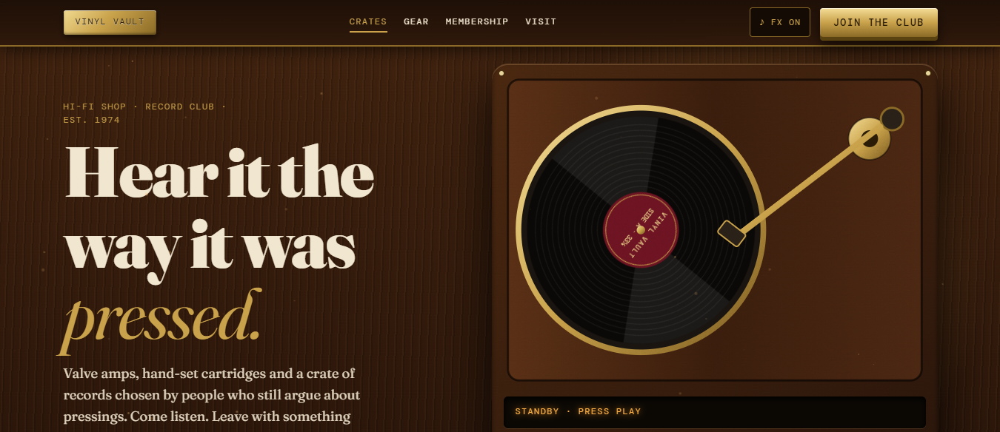
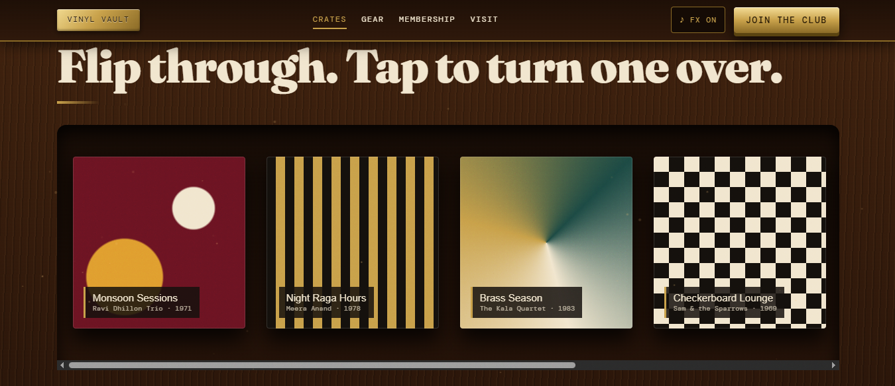
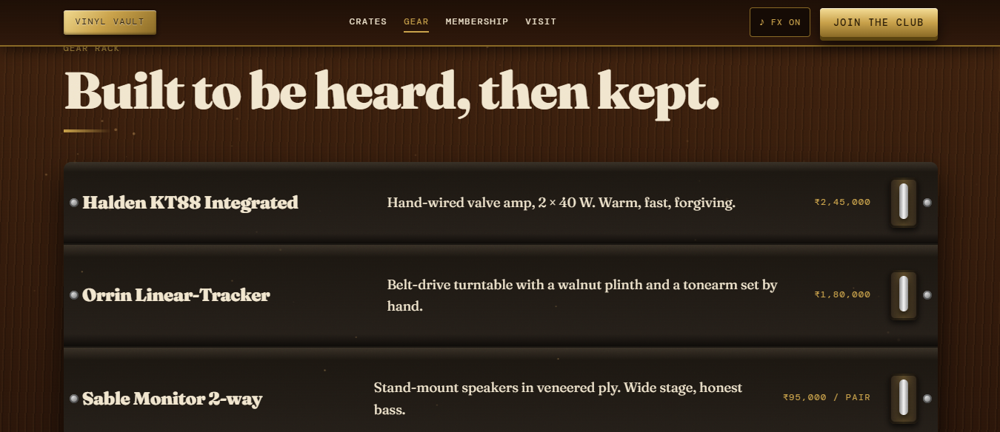
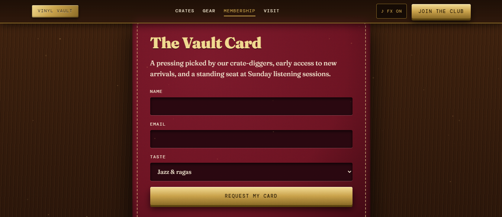
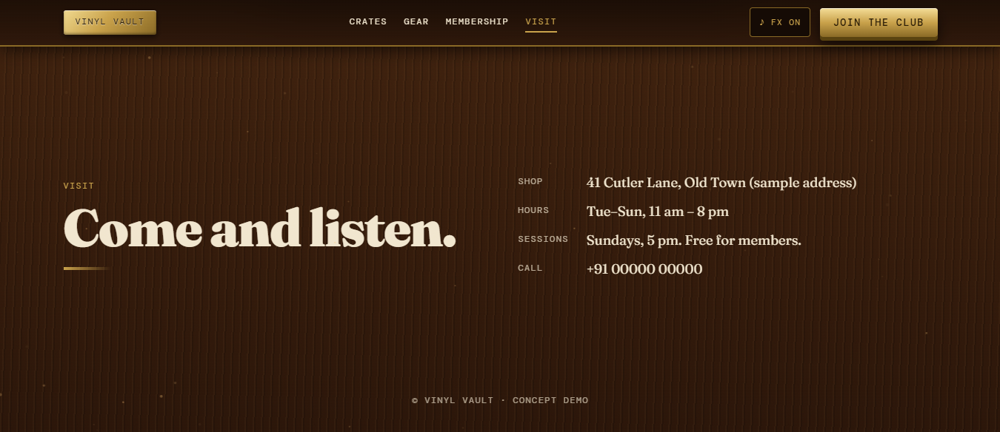

# Vinyl Vault

A skeuomorphic website for a boutique hi-fi shop and record club. Everything looks like a physical object: walnut grain, brushed brass, a spinning turntable, VU meters, knurled knobs and toggle switches. It is a single `index.html` file with no build step.



## Features

- **Working turntable.** Drawn in SVG. The platter spins and the tonearm drops onto the record when the deck scrolls into view.
- **Real sound, generated in code.** The Web Audio API makes the vinyl crackle and a four-chord loop. No audio files are used.
- **Ambience mixer.** Rain on glass, Hearth and Night room play as soft looping layers. They can be combined.
- **Tactile controls.** A draggable rotary volume knob (keyboard accessible), a 33/45 RPM switch and animated VU meters.
- **Comforting UI sound effects.** Soft wood-and-brass clicks, a paper swish when a sleeve flips, and a wind-chime on success. A mute button sits in the nav.
- **Record crates.** Six sleeves with 3D tilt on hover. Tap one to flip it and see the tracklist and price.
- **Gear rack.** Rack-mounted units with reserve switches.
- **Lead form.** The Vault Card form sends submissions to your email through FormSubmit, with a `mailto:` fallback.
- **Smooth scrolling.** Lenis inertial scroll, with a scroll-spy in the nav.
- **No image files.** All artwork and textures are CSS and SVG.

## Screenshots

| | |
|---|---|
|  |  |
|  |  |

## Run it

Open `index.html` in a browser, or serve the folder:

```bash
npx serve .
```

To deploy, drag the folder onto Vercel or Netlify. No configuration is needed.

## Make the form send to your inbox

The form posts to `https://formsubmit.co/ajax/YOUR_EMAIL`. Search `index.html` for `formsubmit.co` and replace the email address with yours.

1. Deploy the site, or open the file locally.
2. Submit the form once.
3. Click the activation link FormSubmit emails to you.
4. From then on, every submission arrives as a table in your inbox.

If the request fails, the page opens a pre-filled `mailto:` draft so no lead is lost.

## Customise

| What | Where |
|---|---|
| Colours | CSS variables at the top of `<style>` (`--wal`, `--brass`, `--cream`, `--ox`, `--char`) |
| Records | The `R` array in the script |
| Gear | The `.unit` rows in the `#rack` section |
| Shop details | The `#visit` section (the address and phone are placeholders) |
| Fonts | Fraunces and DM Mono from Google Fonts |

## Tech

HTML, CSS, vanilla JavaScript, the Web Audio API, [Lenis](https://github.com/darkroomengineering/lenis) 1.1.13 (CDN) and Google Fonts.

## Accessibility

- Visible focus states, and the knob responds to arrow keys.
- `prefers-reduced-motion` is respected, which disables smooth scroll, dust particles and animations.
- Sound only starts after a user gesture.

## Notes

This is a concept demo. The brand, products, prices and address are fictional.

## License

[MIT](LICENSE) © 2026 Manash Khati
